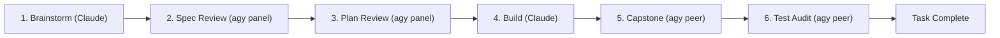
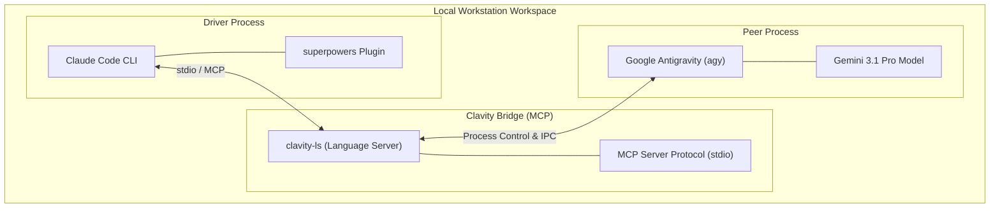

# Diagram Assets Specification

Specifications and Mermaid source for Clavity architecture and workflow diagrams.

## 1. Lifecycle Stages Diagram

## 2. Process Architecture Diagram

## 3. Production Render Specs

- **Export Formats:** Vector SVG and high-resolution PNG (2x retina).
- **Background:** Transparent or `#020713`.
- **Node Styling:** Driver elements colored `#ff4b18`; Peer elements colored `#00cfff`.
